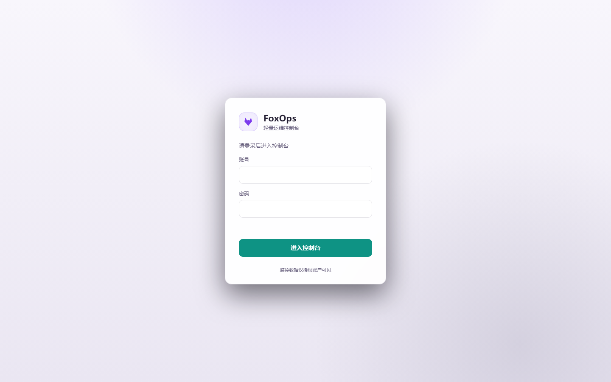
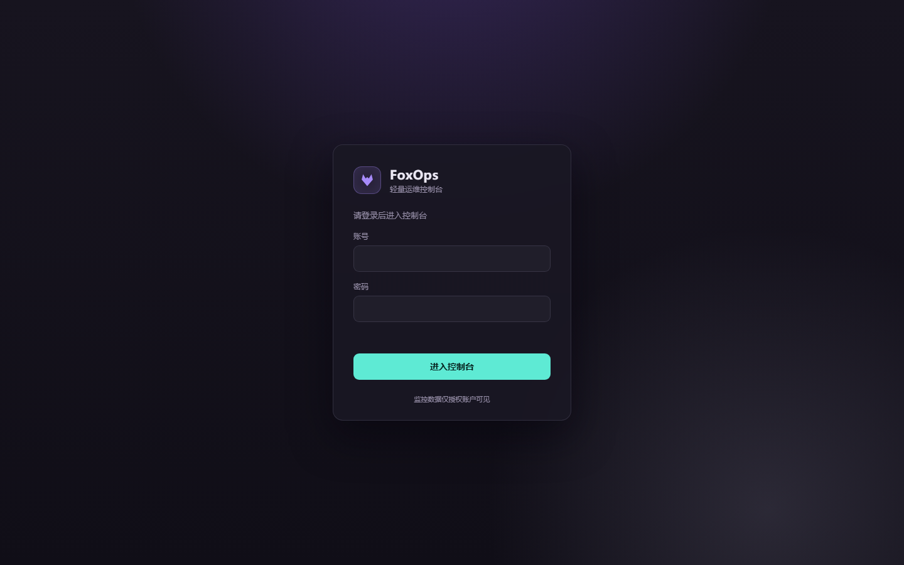
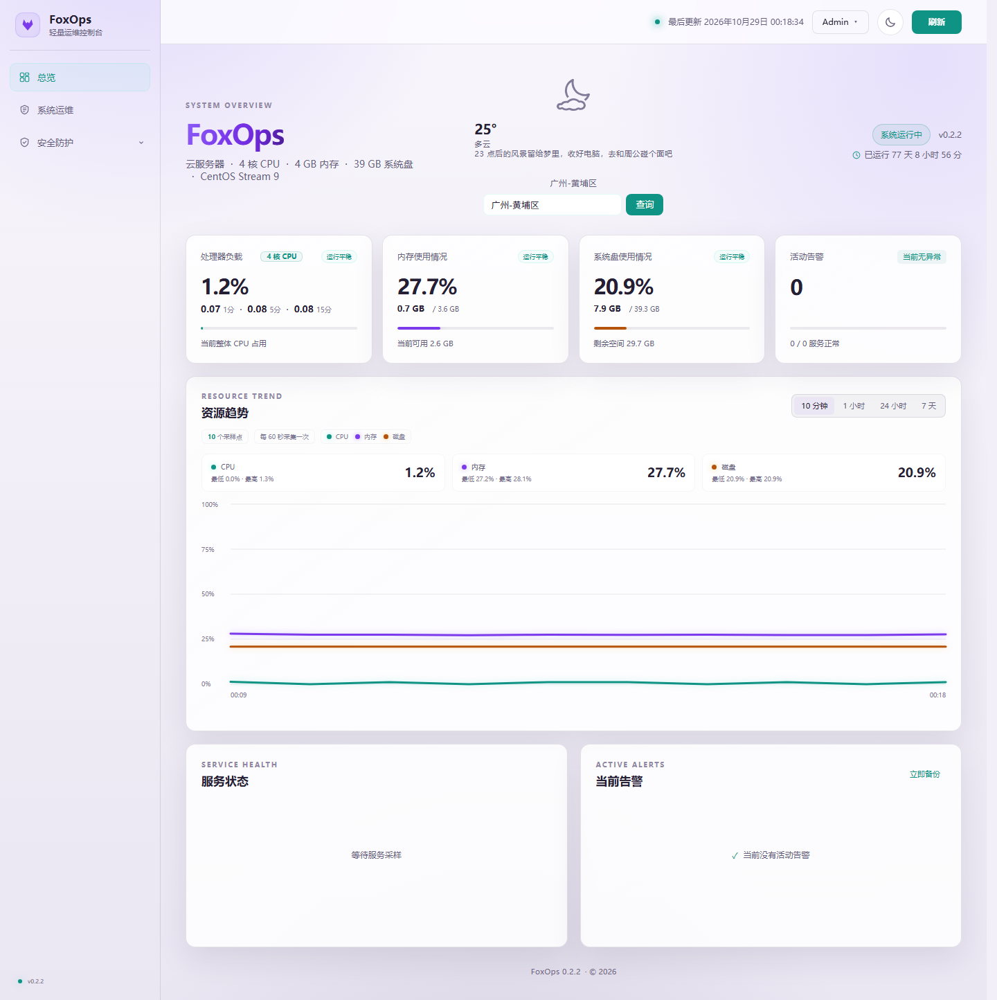
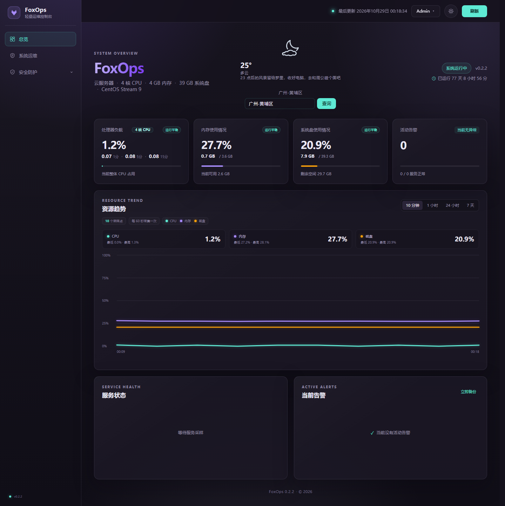
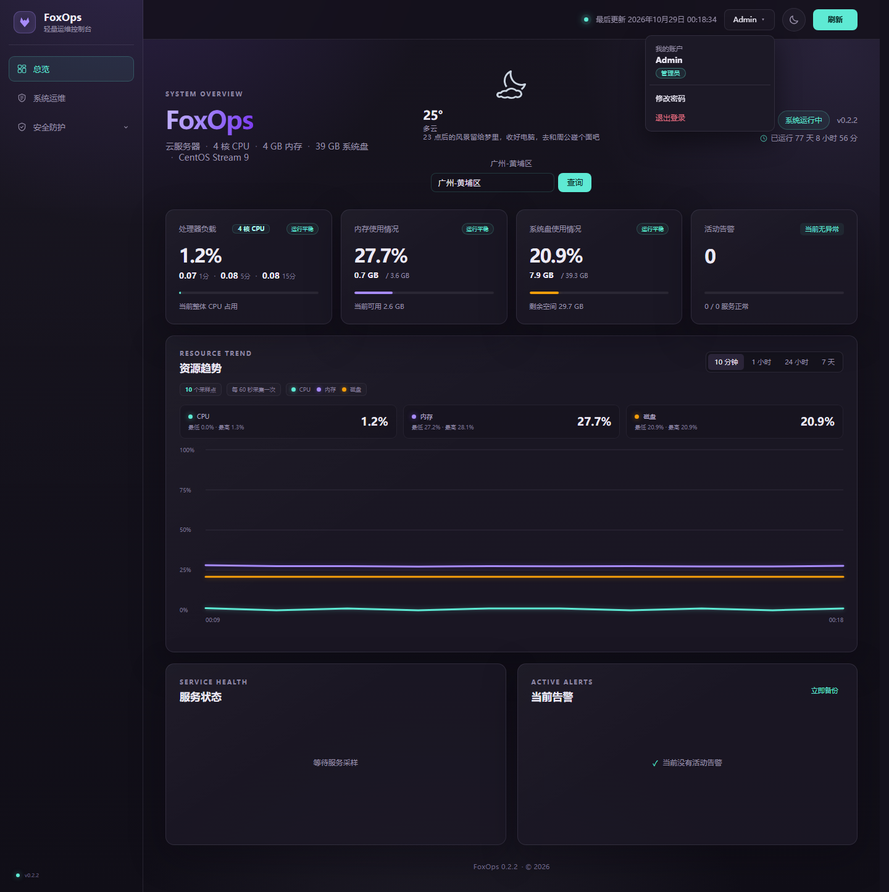

# FoxOps

FoxOps 是一个轻量的 Linux 服务器监控面板，主要功能：

- 实时监控 CPU、内存、系统盘、负载与网络流量
- 趋势图：10 分钟 / 1 小时 / 24 小时 / 7 天
- 资源超阈值自动告警，恢复后自动解除
- 按城市名查询实时天气（支持区级细化）
- 独立登录页，Admin/Guest两级权限
- 一键重启服务、一键备份、审计日志
- 一键切换日间/夜间主题

技术栈：FastAPI + psutil + APScheduler + SQLite，Vue 3 前端，Nginx 反代；提供 Docker Compose 与原生 systemd 两种部署方式。

## 效果截图

### 登录页

独立登录页

| 日间 | 夜间 |
| :---: | :---: |
|  |  |

### 监控面板

主视图含 hero 标题、实时天气（按城市查询，支持细化到区级）、4 张资源卡（CPU/内存/系统盘/活动告警）、10 分钟/1 小时/24 小时/7 天的三线趋势曲线（CPU/内存/磁盘）、服务健康与活动告警两块。左侧是常驻品牌栏——logo 固定在左上角，导航与版本号跟着它一起不随内容滚动；顶栏右侧可见主题切换、立即刷新按钮。

> 截图为 Docker 部署，容器里没有 systemd，所以「服务状态」显示为空；原生 systemd 部署下这里会列出实际服务。

| 日间 | 夜间 |
| :---: | :---: |
|  |  |

### 用户菜单与权限

顶栏用户名按钮下拉：我的账户（带角色徽标）、修改密码、退出登录。重启/备份按钮（仅Admin用户）可见。

## 系统功能

### 监控面板

- 每 60 秒采集 CPU、内存、系统盘的负载情况；
- 左侧导航分「总览 / 系统运维」两栏，管理员另有「安全防护」分组（展开后含「后台管理」）；总览看历史与告警，系统运维看秒级实时；
- 资源卡展示 CPU 核数、内存/磁盘"已使用 / 总容量"；
- 趋势图支持 10 分钟、1 小时、24 小时、7 天记录，根据最近采样点来显示精确数值；
- 服务状态：监控安装器识别并写入白名单的 systemd 服务；
- 活动告警：CPU/内存/磁盘超阈值自动产生，恢复后自动解除告警状态；
- 城市天气：自持按城市名查询当地实时天气，细分到区级天气。

### 系统运维

- 独立采样线程每秒读一次 CPU / 内存 / 磁盘，不写数据库——看的是"此刻"，不是历史；
- CPU：总占用、每核占用柱、1/5/15 分钟负载；
- 内存：已用 / 总量 / 可用，含 Swap；
- 磁盘：每个分区用量 + 整盘读写速率，外加最近 90 秒 CPU / 内存 / 磁盘三线实时走势；
- Docker 容器：`docker ps -a` 列出名称、镜像、状态、端口映射，`docker stats` 补 CPU 与内存占用，运行中的排前面；
- Docker 数据来自 root 侧探针（`foxops-docker.timer` → `/var/lib/foxops/docker.json`），`foxops` 用户不碰 docker.sock——docker 组等于 root 级控制权，服务端只读文件。

### 账户与权限

- 独立登录页 ：全新界面，未登录访问面板自动跳转，登录成功回跳；
- 两级角色：**Admin（管理员）** 拥有全部权限，**Guest（访客）** 仅支持查看面板；
- 管理操作（重启服务、立即备份、审计日志）由后端强制门禁：仅管理员（ Admin ）会话可通行，访客会话一律 403，前端同时隐藏对应按钮；
- 修改密码后所有旧会话立即失效，强制重新登录；
- 密码以 PBKDF2-HMAC-SHA256 哈希存储，登录会话仅保存在当前浏览器标签页（sessionStorage），关闭标签页即失效。

### 运维操作

- 一键重启白名单内的 systemd 服务；
- 手动触发 SQLite 一致性备份，同时清理超过保留期的历史数据；
- 审计日志记录登录、退出、改密码、重启、备份等关键操作。

### 安全与个性化体验

- **DDoS 防护**：Nginx 先按来源 IP 限速限连（原生部署 API 20 次/秒、静态 50 次/秒，Docker 内置代理统一 30 次/秒；单 IP 32 条并发连接、1 MiB 请求体上限与慢速攻击超时），应用层再按 IP 做双窗口令牌桶限速、每 IP 与进程级并发上限，超限 429；反复违规的来源自动封禁（首次 10 分钟，逐次翻倍，最长 24 小时），封禁期 403；
- **安全防护页（仅 Admin）**：看到最近一分钟请求/拦截量、正在封禁的来源与剩余时间、高频来源榜和当前限流策略，可一键解封误伤来源（写审计日志）；右上角时钟与服务器时间同步、每秒更新；
- **后台管理页（仅 Admin，侧栏安全防护展开进入）**：在线调整限流与封禁策略（开关、双窗口限速、并发、请求体、封禁规则），保存立即生效并持久化到数据卷 SQLite，重启后仍沿用；「恢复环境默认」删除自定义值；所有修改与重置都写审计日志；
- 白名单与本机回环永不被拦，真实 IP 只从受信反代（回环 / 内网网段）的 `X-Real-IP`、`X-Forwarded-For` 取，伪造请求头绕不过限速；
- 严格 CSP（script-src 'self'，无 unsafe-eval）、Permissions-Policy、隐藏 Nginx 版本号；
- 可自定义化的 404/429/500 错误页，静态资源 gzip 压缩；
- 日间/夜间主题一键切换：顶栏太阳/月亮按钮附带动画切换，同时将用户偏好主题写入记忆，首次访问跟随系统偏好；
- 前端所有请求 10 秒超时，切换趋势范围时不会出现旧请求覆盖新数据。

## 技术实现思路

### 后端

- **采集与调度**：`collector` 模块用 psutil 读取系统指标，APScheduler（后台线程池）驱动"采集 + 每日维护"两个任务，采集频率与保留期可配置；
- **存储**：SQLite（WAL 模式）单文件存储指标、服务采样、告警、审计日志与用户会话；指标与审计默认保留 7 天，每日 3 点清理过期数据并做一致性备份；
- **认证与授权**：登录签发随机会话 token（7 天有效），密码 PBKDF2 哈希；用户表带 `role` 列区分 admin/guest；管理操作通过 FastAPI 依赖注入 `require_admin_access` 统一门禁——仅 admin 角色会话放行，访客会话返回 403，无凭证会话返回 401；
- **DDoS 防护**：`defense` 模块以 ASGI 中间件挂在最外层，先于路由完成 IP 识别、双窗口令牌桶限速、并发计数与封禁判定，被拦的请求不再进入路由、数据库或静态文件处理；封禁与拦截计数留在内存（默认跟踪 4096 个来源），不写库，采集线程每分钟把拦截量折成一条活动告警；手工解封走受保护接口并落审计日志；限流策略可在「后台管理」热更新，覆盖值存 SQLite `app_settings`，启动时优先于环境变量；
- **API 设计**：只读数据接口（summary/metrics/services/alerts/weather）不设门槛保证面板可用，写操作集中收口到受保护接口，风险面最小。

### 前端

- **零构建发布**：Vue 3 运行时 + `@vue/compiler-dom` 离线预编译的 `render.js`（由 `tools/generate-render.mjs` 从 index.html 生成），发布包不含 CDN 依赖、不含图表库，趋势曲线用原生 SVG 绘制；
- **独立登录页**：`login.html` 使用原生 JavaScript，与面板完全分离，聚焦认证单一职责；
- **状态管理**：登录会话由共享的 `session.js` 读写 sessionStorage，天气偏好同样存 sessionStorage；主题偏好由独立 `theme.js` 集中读写 localStorage（`foxops_theme`），`app.js` 不触碰 localStorage，面板与登录页共享同一套偏好。

### 部署

- **跨发行版自适应**：安装器组合读取 /etc/os-release、PID 1、包管理器、架构、命令实际路径与 systemd unit 后自动选择方案，支持 Ubuntu/Debian 与 RHEL 系（dnf/yum），非 systemd 或容器环境安全停止而非猜测；
- **进程拓扑**：Uvicorn 单 worker 仅监听 127.0.0.1:8000，Nginx 反代到配置端口，systemd `MemoryMax=400M` 限制内存占用；
- **最小权限**：foxops 系统用户 + sudoers 白名单（仅允许重启白名单服务），运行配置存 0640 root:foxops；
- **发布与回滚**：`tools/build-release.py` 确定性构建发布包并计算 SHA-256，升级流程在临时目录预检、备份后安装，失败自动回滚。

## 从 0 到 1 部署项目

先解压源码，进入包含本 README 的目录，以普通用户执行只读预检：

~~~bash
bash deploy/preflight.sh
~~~

只有当输出为： preflight=PASS 时才继续。此系统默认配置可直接使用；若需要改端口、域名显示或服务选择时，修改下面配置：

~~~bash
vi config.env
~~~

然后以 root 权限执行：

~~~bash
bash deploy/install.sh
~~~

安装器将自动识别系统与架构、安装运行依赖、创建 foxops 用户/虚拟环境、生成 Nginx 配置与 sudoers 白名单、启动并做健康检查。安装器不会修改 MySQL/Redis 配置或认证，不会自动修改云安全组/防火墙，也不会默认创建 Swap。

## 用 Docker 部署

不想装 systemd 单元与虚拟环境时，直接用仓库自带的 `docker-compose.yml`：

~~~bash
docker compose up -d --build                  # 面板（web + app），默认对外 8080
FOXOPS_PUBLIC_PORT=1225 docker compose up -d  # 换对外端口
docker compose --profile docker-panel up -d   # 额外启用「容器总览」探针
docker compose logs -f app                    # 看日志
~~~

要点：

- **宿主机指标**：`app` 以只读方式把宿主机根挂到 `/host`，并用 `FOXOPS_PROCFS_PATH=/host/proc` 让 psutil 读宿主机 `/proc`；不想要这份权限就删掉该挂载与两个 `FOXOPS_*` 变量，面板退化为只统计容器自身。
- **systemd 功能降级**：容器里没有 systemd，服务状态列表为空、重启按钮不可用（`FOXOPS_SYSTEMCTL_PATH=/bin/false` 静默降级），指标、趋势、告警、天气、备份、容器总览都正常。
- **数据**：SQLite 与备份落在命名卷 `foxops-data`（`docker volume inspect foxops-data` 查真实路径），删容器不丢数据。
- **安全头**：`docker/nginx.conf` 与 `deploy/foxops.nginx.conf` 保持同一套 CSP / X-Frame-Options / Referrer-Policy 响应头。
- **配置**：所有 `FOXOPS_*` 都可以写在根目录 `.env` 里（compose 自动读取），例如 `FOXOPS_PUBLIC_PORT=1225`、`FOXOPS_CPU_THRESHOLD=80`。
- **升级镜像**：发布包把文件 mtime 归一成 0，BuildKit 可能判定"上下文没变"而复用旧层（镜像 tag 变了、里面还是旧代码）。覆盖源码后先 `find app docker -exec touch {} +` 再 `docker compose --profile docker-panel up -d --build`；部署完成必须核对 `/api/health` 的 `version` 与 `app/__init__.py` 一致。改了 `docker/nginx.conf` 或 `app/static` 还要 `docker compose up -d --force-recreate web`（两者都是 bind mount，容器会握着旧 inode）。

## 修改管理员密码

首次部署后，**Admin（管理员）与 Guest（访客）的初始密码均为 `123456`**，请务必在部署完成后立即修改，尤其是管理员账号。

修改步骤：

1. 打开面板地址，使用 Admin 账号登录；
2. 点击顶栏右侧的用户名按钮，在下拉菜单中选择「修改密码」；
3. 在弹窗中依次输入原密码、新密码并确认，点击提交；
4. 修改成功后提示「密码已更新，请重新登录」，所有旧会话立即失效，需用新密码重新登录。

说明：

- 新密码长度至少 6 位，以 PBKDF2-HMAC-SHA256 哈希存储，不会在数据库中保存明文；
- Admin 与 Guest 用户均可通过该入口修改自己的密码，改密码操作会记录到审计日志；
- 若 Guest （访客）忘记密码，请联系服务器管理员处理。

## 可配置项

config.env 中包含全部首次部署选项。常用项：

- FOXOPS_PUBLIC_PORT=8080
  对外监听端口，整数 1-65535，不得为 8000（与 Uvicorn 私有监听端口冲突）；
- FOXOPS_SERVER_NAME=_
  Nginx server_name，允许 A-Za-z0-9._*-，默认 `_` 表示匹配所有请求；
- FOXOPS_PUBLIC_HOST=SERVER_IP
  对外主机名或 IP（允许 A-Za-z0-9._:-），安装完成后用其拼接面板访问地址；
- FOXOPS_CLOUD_PROVIDER=auto
  云厂商标识，auto 表示自动探测，手工指定时不得包含单引号；
- FOXOPS_*_SERVICE=auto
  受监控的 systemd 服务名，auto 表示自动探测，未安装的候选会被忽略；
- FOXOPS_ENABLE_SWAP=0
  是否由安装器创建 Swap，取值 0 或 1，创建属于系统级变更需先取得明确授权。

auto 服务检测候选：

- Nginx：nginx
- MySQL/MariaDB：mysqld、mysql、mariadb
- Redis：redis、redis-server

可选服务未安装时会被忽略。若手工指定了不存在的服务名，安装会失败并说明原因。

### 运行时配置（/etc/foxops/foxops.env）

DDoS 防护的相关项写在运行配置里，改完执行 `foxopsctl restart` 生效。安装器只负责首次写入下列四项默认值，之后保留管理员改过的值；其余细项按需手工追加。**这些环境变量是默认值**：在「后台管理」页保存过策略后，以界面保存的值为准（存于数据库），「恢复环境默认」会删除该覆盖。

- FOXOPS_SECURITY_ENABLED=1
  是否启用请求级限速与自动封禁，取值 0 或 1；
- FOXOPS_SECURITY_BURST_LIMIT=60
  短窗口突发上限（次），配合 `FOXOPS_SECURITY_BURST_WINDOW_SECONDS`（默认 10 秒）；
- FOXOPS_SECURITY_SUSTAINED_LIMIT=300
  长窗口持续上限（次），配合 `FOXOPS_SECURITY_SUSTAINED_WINDOW_SECONDS`（默认 60 秒），不得低于突发上限；
- FOXOPS_SECURITY_BAN_SECONDS=600
  首次自动封禁时长（秒），重复违规逐次翻倍，由 `FOXOPS_SECURITY_MAX_BAN_SECONDS`（默认 86400）封顶；
- FOXOPS_SECURITY_MAX_CONCURRENT=24 / FOXOPS_SECURITY_MAX_GLOBAL_CONCURRENT=200
  单 IP 与进程级并发请求上限；
- FOXOPS_SECURITY_STRIKE_LIMIT=3 / FOXOPS_SECURITY_STRIKE_WINDOW_SECONDS=300
  多少次违规、在多长窗口内累计会触发封禁；
- FOXOPS_SECURITY_MAX_BODY_BYTES=1048576
  请求体上限（字节），默认 1 MiB，超限返回 413；
- FOXOPS_SECURITY_MAX_TRACKED_IPS=4096
  内存中最多跟踪多少来源 IP，超出后淘汰最久未出现的；
- FOXOPS_SECURITY_ALLOWLIST=127.0.0.1/32,::1/128
  永不限速的 CIDR，默认只放行本机回环；
- FOXOPS_SECURITY_TRUSTED_PROXIES=127.0.0.0/8,::1/128,10.0.0.0/8,172.16.0.0/12,192.168.0.0/16
  受信反代网段；只有这些来源传来的 `X-Real-IP` / `X-Forwarded-For` 会被采信。

Nginx 侧的限速阈值（`limit_req_zone`、`limit_conn`、超时）在 `deploy/foxops.nginx.conf` 与 `docker/nginx.conf` 中，改动后执行 `foxopsctl nginx-reload` 或重启容器。

## 运行结构

| 资源 | 位置或限制 |
|---|---|
| 应用 | /opt/foxops |
| Python 虚拟环境 | /opt/foxops/.venv |
| SQLite 数据 | /var/lib/foxops/foxops.db |
| 自动备份 | /var/lib/foxops/backups |
| 运行配置 | /etc/foxops/foxops.env，0640 root:foxops |
| 非敏感部署信息 | /etc/foxops/deployment.env |
| systemd unit | /etc/systemd/system/foxops.service |
| Nginx 站点 | /etc/nginx/conf.d/foxops.conf |
| sudoers 白名单 | /etc/sudoers.d/foxops |
| Uvicorn | 仅 127.0.0.1:8000，单 worker |
| systemd 内存上限 | MemoryMax=400M |
| 默认公网入口 | TCP 8080，可配置 |

## 日常操作

~~~bash
foxopsctl status
foxopsctl health
foxopsctl logs 100
foxopsctl restart
foxopsctl backup
foxopsctl nginx-reload
foxopsctl url
sudo foxops-verify
~~~

命令说明：

- foxopsctl status：查看 foxops 服务状态（systemctl status，含进程与内存占用）；
- foxopsctl health：调用本地健康检查接口，输出服务健康状态；
- foxopsctl logs 100：查看服务最近日志，默认 100 行，行数可自定义；
- foxopsctl restart：重启 foxops 服务并等待健康检查通过（15 秒超时）；
- foxopsctl backup：执行数据库一致性备份并清理过期历史数据；
- foxopsctl nginx-reload：先验证 Nginx 配置语法，通过后重载 Nginx；
- foxopsctl url：显示面板访问地址；
- sudo foxops-verify：以 root 运行部署验收检查，确认安装结果完整可用。

管理操作一律走 Admin 登录会话，无需再引入任何第二套凭证。**以安全起见，请务必记住不要把 SSH 私钥、MySQL 密码或 Redis 密码粘贴到任何会话聊天中。**

## 修改前端

离线编译工具已锁定在 tools/package-lock.json：

~~~bash
npm ci --prefix tools
npm run render --prefix tools
node --check app/static/render.js
node --check app/static/app.js
~~~

修改 app/static/index.html 后必须重新生成 app/static/render.js。不要手工编辑生成文件，也不要把 CSP 放宽到 unsafe-eval。
`tools/build-release.py` 会在打包前重新编译一次并与已提交的 render.js 做比对，不同步就直接失败，避免发布包带上旧模板。

## 测试

先在开发虚拟环境安装锁定的运行与测试依赖：

~~~bash
python -m pip install -r requirements-dev.txt
~~~

先安装锁定的开发与测试依赖（含 FastAPI TestClient 等测试所需包），再执行以下测试：

~~~bash
python -m compileall -q app tests
python tests/smoke.py
python tests/api_smoke.py
python tests/defense_smoke.py
python tests/frontend_smoke.py
node --check app/static/app.js
node --check app/static/render.js
bash tests/platform_detection.sh
bash tests/install_helpers.sh
bash tests/nginx_template.sh
bash -n deploy/lib/platform.sh deploy/lib/config.sh deploy/preflight.sh deploy/install.sh
bash -n deploy/foxopsctl deploy/verify-server.sh
~~~

测试命令说明：

- python -m compileall -q app tests：编译全部 Python 源码，检查语法错误；
- python tests/smoke.py：冒烟测试，用临时目录隔离数据库，验证建库、指标采集等核心流程；
- python tests/api_smoke.py：API 冒烟测试，用 FastAPI TestClient 验证健康检查与各接口行为；
- python tests/defense_smoke.py：DDoS 防护测试，用极小阈值验证限速 429、超大请求 413、反复违规升级封禁 403、手工解封与真实 IP 解析；
- python tests/frontend_smoke.py：前端静态检查，解析 HTML/JS，校验 id 引用、内联脚本/样式与 CSP 约束；
- node --check app/static/app.js / render.js：对前端 JS 文件做语法检查（render.js 为生成文件）；
- bash tests/platform_detection.sh：测试跨发行版平台识别逻辑（os-release、架构、包管理器等）；
- bash tests/install_helpers.sh：测试安装辅助函数（如配置写入 foxops_write_env_setting）；
- bash tests/nginx_template.sh：测试 Nginx 配置模板的端口、server_name 变量替换；
- bash -n deploy/...：对全部部署 shell 脚本做语法检查（不执行）。

发行版分支测试使用隔离的 /etc/os-release、架构和包管理器夹具，不会修改测试主机。真实发布仍需在目标服务器执行预检、安装和验收。
